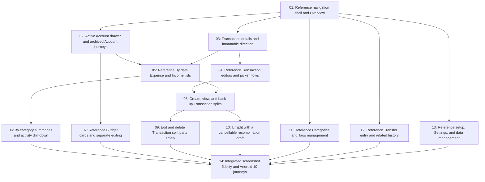

# UI Reference Refresh implementation map

Parent: [UI Reference Refresh and Transaction Splits](spec.md)

Approved plan: [ticket breakdown](ticket-plan.md). The user approved all 14 ticket sizes and blocking edges on 2026-11-23. Every ticket is published separately with Status: ready-for-agent; none is claimed or implemented. Publication does not authorize implementation.

## Implementation map

| Issue | Blocked by | Status |
| --- | --- | --- |
| [01: Reference navigation shell and Overview](issues/01-reference-navigation-shell-and-overview.md) | None | ready-for-agent |
| [02: Active Account drawer and archived Account journeys](issues/02-active-account-drawer-and-archived-account-journeys.md) | 01 | ready-for-agent |
| [03: Transaction details and immutable direction](issues/03-transaction-details-and-immutable-direction.md) | 01 | ready-for-agent |
| [04: Reference Transaction editors and picker flows](issues/04-reference-transaction-editors-and-picker-flows.md) | 03 | ready-for-agent |
| [05: Reference By date Expense and Income lists](issues/05-reference-by-date-expense-and-income-lists.md) | 02, 03 | ready-for-agent |
| [06: By category summaries and activity drill-down](issues/06-by-category-summaries-and-activity-drill-down.md) | 05 | ready-for-agent |
| [07: Reference Budget cards and separate editing](issues/07-reference-budget-cards-and-separate-editing.md) | 02 | ready-for-agent |
| [08: Create, view, and back up Transaction splits](issues/08-create-view-and-back-up-transaction-splits.md) | 04, 05 | ready-for-agent |
| [09: Edit and delete Transaction split parts safely](issues/09-edit-and-delete-transaction-split-parts-safely.md) | 08 | ready-for-agent |
| [10: Unsplit with a cancellable recombination draft](issues/10-unsplit-with-a-cancellable-recombination-draft.md) | 08 | ready-for-agent |
| [11: Reference Categories and Tags management](issues/11-reference-categories-and-tags-management.md) | 01 | ready-for-agent |
| [12: Reference Transfer entry and related history](issues/12-reference-transfer-entry-and-related-history.md) | 01 | ready-for-agent |
| [13: Reference setup, Settings, and data management](issues/13-reference-setup-settings-and-data-management.md) | 01 | ready-for-agent |
| [14: Integrated screenshot fidelity and Android 10 journeys](issues/14-integrated-screenshot-fidelity-and-android-10-journeys.md) | 06, 07, 09, 10, 11, 12, 13 | ready-for-agent |

## Work frontier

- No tickets are resolved or claimed.
- Dependency-eligible: [01: Reference navigation shell and Overview](issues/01-reference-navigation-shell-and-overview.md). This is eligibility only, not an instruction to implement.
- Tickets 02-14 wait until every listed prerequisite is resolved. A ready-for-agent triage label does not bypass blocking edges.
- After 01 resolves, 02, 03, 11, 12, and 13 become eligible. Recompute eligibility from direct blocking edges and resolved states after each completion.

## Dependency graph

## Parent-spec coverage

| Ticket | Primary user stories |
| --- | --- |
| [01](issues/01-reference-navigation-shell-and-overview.md) | 1-10, 12, 21-22, 30-32, 98-100 |
| [02](issues/02-active-account-drawer-and-archived-account-journeys.md) | 12-29, 31, 87, 95-97 |
| [03](issues/03-transaction-details-and-immutable-direction.md) | 42-46, 59 |
| [04](issues/04-reference-transaction-editors-and-picker-flows.md) | 45-59 |
| [05](issues/05-reference-by-date-expense-and-income-lists.md) | 5-6, 10, 12, 21-22, 33-35, 39-41 |
| [06](issues/06-by-category-summaries-and-activity-drill-down.md) | 36-40 |
| [07](issues/07-reference-budget-cards-and-separate-editing.md) | 11, 24-26, 29, 82-86, 95 |
| [08](issues/08-create-view-and-back-up-transaction-splits.md) | 60-70, 78-81, 95-97 |
| [09](issues/09-edit-and-delete-transaction-split-parts-safely.md) | 62, 71-75, 79-81, 95-97 |
| [10](issues/10-unsplit-with-a-cancellable-recombination-draft.md) | 76-79, 95-97 |
| [11](issues/11-reference-categories-and-tags-management.md) | 4, 52-53, 88 |
| [12](issues/12-reference-transfer-entry-and-related-history.md) | 10, 41, 89, 95 |
| [13](issues/13-reference-setup-settings-and-data-management.md) | 8, 48, 90-91, 95-98 |
| [14](issues/14-integrated-screenshot-fidelity-and-android-10-journeys.md) | 1-100, especially 92-94, 98-100 |

Stories 1-6 and 92-100 apply to each relevant owning slice as shared requirements. Repeated coverage requires cross-feature verification, not permission to leave an owning behavior incomplete. Every ticket links parent stories/decisions, carries observable criteria, and names its critical test journeys.

## Delivery rules

- Match named references as closely as possible in layout, spacing, typography, colors, icons, and placement, with only agreed adaptations. Capture normal/large-font evidence and correct visual defects in each owning ticket.
- Each vertical slice includes public behavior, persistence/migrations/Backup where applicable, UI, tests, and screenshots. Transaction split creation owns durable relationships and safe Backup support immediately; later mutation slices extend that contract.
- Category summaries and Budget presentation do not block allocation creation. Whichever branch lands later verifies combined part-aware outputs. Never expose unsafe ordinary single-record mutations for grouped data or dead capability controls.
- The final ticket integrates complete journeys and fixes cross-screen defects; it does not replace feature-level tests, screenshot comparison, or completion checks.
- Resolve a ticket only after its acceptance criteria and the complete [ticket completion checklist](../../docs/research/ai-ui-testing.md#ticket-completion) pass and its Answer records results/evidence. Use the confirmed public test boundaries and Android 10; do not add a manual TalkBack/Switch Access gate.
- Work only on dependency-eligible tickets after implementation is separately instructed. On claim set Status: claimed; on completion append an Answer, set Status: resolved, and update this map/frontier. Retain canonical triage labels and direct blocking edges.
- This map belongs to the new effort. Keep the already-implemented Personal Finance Design spec, tickets, map, and historical verification unchanged.
